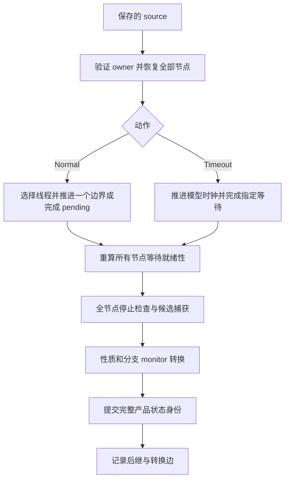

# DetSim 技术与实验报告（2026-10-17）

本报告同时回答两个问题：现在实际测通了哪些案例，以及当前保存、恢复与执行控制到底实现到了什么程度。核心源码基线为 `17ef7fc`；实验分别注明实际使用的不可变 tracer，不能把旧二进制的结果统称为最新版结果。文中的“通过”始终受具体目标、运行时、模型、搜索策略和资源边界约束。

原始结果保存在本文列出的本机 `build/` 路径，报告正文保留主要数字和统计定义。这些构建产物没有作为永久制品提交；清理构建目录会使部分原始证据不可再用。实验并非 Linux 兼容性认证，也不证明所有交织已经被穷举。

## 1. 当前进度和统计口径

计量环境为 Linux 6.12.105 Debian x86-64，AMD Ryzen 5 2600（12 个可用逻辑处理器），约 31.1 GiB RAM；系统编译器 GCC/G++ 14.2.0，glibc 2.41。性能采样使用本机可工作的 `linux-tools-6.8.0-138/perf`。案例和基准存在并发实验负载，不是隔离实验室；具体逐行样本采集于 **2026-10-17 06:18:02–06:18:04 UTC（北京时间 14:18）**。环境证据见 `build/technical-report-2026-10-17/environment.json`。

### 1.1 先给结论

- 非 Java 的原验收矩阵共 **60 行**，每个 variant/backend 独立占一行：**56 行已有核验通过，真实 RedisRaft 的两个 full 行仍失败，两个 pages 行正在重试搜索**。失败历史保留，不以重试覆盖成通过。
- 56 行中，C/C++ 输入与 pthread 共 12 行来自 immutable23；运行时准入 12 行、运行时并发 24 行来自 immutable22；两种 Raft 库共 8 行保留各自实际执行版本的证据。
- 另外有 RedisLabs/raft 的 NORMAL 复制 quorum 与重选举后日志修复实验，各有 healthy/mutant × full/pages 四行。这八行是补充协议实验，不重复计入原 60 行。
- Java 是用户明确允许权衡的条件目标，当前没有取得 model-checking 通过。它没有因为从主矩阵单列而变成成功。可选 Python Queue 也仍因文件 EOF/SIGBUS 映射语义未覆盖而不通过。
- 同一组受控进程内的恢复、三次终点/反例重放和跨启动逐字节确定性是不同的验收项。固定布局诊断已经发现布局以外的启动差异，后文单独说明。

主矩阵证据：`build/case-jobs/final-kernel24-audit/matrix.json`。该收集器是证据审查工具，不负责启动 workload；其结果不替代具体案例的原始 transcript、性质 oracle 和恢复重放。

### 1.2 数字的含义

| 指标 | 本报告采用的含义 | 不能等同于 |
| --- | --- | --- |
| visited / searched | 对应 runner 或自动搜索打印的访问量，保留原字段含义 | 全部互异状态数 |
| new | 该轮搜索报告的新增状态量 | 跨启动、跨后端规范化后的状态数 |
| executed action | 实际从某个 source 发出的执行/超时动作 | 一定产生不同后继的动作 |
| layer | case-side 搜索实际展开的 source 层数 | 任意 DFS 的最大深度，或所有路径都到达的深度 |
| depth bound | 命令请求的深度上界 | 实际已走深度 |
| preset 0/1 | 控制器发送的正常执行参数 | 此步一定遇到了有效的二选一环境输入 |
| timeout | 指定 pending 等待的显式截止时间转换 | 宿主真实时间自动流逝 |
| step reply | 一次完整 `si` 回复，排除明确阻塞拒绝时另行注明 | 程序经历的全部内核 syscall，或唯一新状态 |
| packed object | 一个 StateStore 不可变对象 | 一个全局状态；pages 下还包含页和 VFS 内容对象 |
| 镜像大小 | 明确区分逻辑映射字节、root 记录、引用对象、全库文件长度 | 目标 RSS，或 tracer 和子进程总内存 |
| search time | 有明确边界的搜索时间 | 编译、初始化、重放、清理的全程时间 |
| whole-driver time | 计时器实际覆盖的初始化、搜索、检查、重放和清理 | 原生 oracle 或构建时间，除非特别注明 |

旧日志没有统一的“所有 guest syscall 实际进入次数”和“有效 choosepoint 被消费次数”计数器。`info current`、历史输出、重放会重复显示 syscall；直接 grep 名称会把观察当成执行。本报告不这样计数：能从动作账本或完整命令回复确认的量单列，自动搜索未记录的真实总调用数标为未记录。框架为恢复而注入的 `mmap/mprotect/madvise` 等控制 syscall 也不能混进目标程序调用量。

### 1.3 案例分别证明什么

| 案例 | 正常目标 | 缺陷或反例目标 | 主要限制 |
| --- | --- | --- | --- |
| C/C++ two-debits | 两次时间输入后的余额与退出正确 | 删除第二次扣款余额检查，输入 `11` 触发 overdraft | 小型有限输入程序，不是并发覆盖证明 |
| pthread lost-notification | 条件变量生产者/消费者完成 | 遗漏 signal，闭合世界里全部活线程停在 untimed futex 等待 | 现有 actor 策略下的有界案例 |
| runtime-admission | 保存的 stdout 出现 `RUNTIME_OK`，退出 0，受控边和终点重放 | 不设人为缺陷；用于暴露第一个不支持的运行时行为 | 小探针通过不代表整个语言运行时完全兼容 |
| Rust/Python/Go producer-consumer | 精确输出 `EXACT_ONCE 0 1` | omit 输出缺项；duplicate 输出重复项；检查器必须报对应性质 | 不穷尽 goroutine、线程或共享内存交织 |
| willemt/raft | 三节点选举、命令提交及可读协议检查点 | owned 副本中的精确投票/选举 guard 变更，检查对应安全性 | 受限固定成员场景；不含任意 compaction/crash |
| RedisLabs/raft election | 真实 pre-vote、选举、命令提交与明确拒绝收据 | owned 副本中的选举 guard 缺失 | 保留库的引用所有权；不是 Redis module |
| RedisLabs/raft NORMAL quorum | 首个 NORMAL 提交前开始搜索，确认 exact payload 已有多数副本 | median match 改为 max，检测一份副本即提交 | 固定三个 voter，不含任意成员变化 |
| RedisLabs/raft suffix repair | 隔离旧 leader，重选举并修复旧日志 | 关闭 previous-log-term 检查，检测已提交内容冲突 | 有界隔离/恢复场景，不是完整 Raft 证明 |
| 真实 Redis + RedisRaft module | SET/提交确认/GET 历史，跨节点 committed prefix 与本地值一致 | owned module 中跳过指定节点 alpha 的本地 apply | native oracle 已通过，model 业务验收尚未完成 |

条件变量案例检测的是闭合世界的等待/通知性质，不是一般 C/C++ data race 检测；发现注入缺陷证明对应受控路径、观察与反例管线工作，不证明搜索完备。

缺陷副本保存在自有构建目录；没有把 workload 特判加入通用调度、状态存储或恢复代码。性质观察通过插件和保存状态进行，不以无法取得语义字段为理由制造成功。

### 后续运行记录：2026-10-17 06:49 UTC 以后

下面第 2 节的 68 行计量仍保持 06:18 UTC 的原始截面，不把新尝试套进旧数字。后续真实 pages22 两组的实际候选执行都出现 `ack alpha=17,index=7` 及 `before_set beta`；这说明已越过旧记录缺失的第一条提交确认，但候选观察不是完整保留路径/终态验收。

随后启动 healthy/full 的 immutable23 重试：worker 3228026、driver 3228027、tracer 3228125，独立输出 `/mnt/k2/detsim-modelcheck/iteration23-healthy-full/run-y4tcscgq`。模型时限 43,200 秒，搜索请求 36,000 秒，depth 6,000，4 GiB tracer 地址空间。只对此输出树按 20 秒采样检查 96 GiB 文件长度阈值，另保留至少 32 GiB 文件系统空闲；这是软阈值，不是硬 quota。监控异常、截断和不完整清理均非绿色。

这次重试已完成自己的 native 前置并进入控制执行，尚无 model 结果；另外两组 pages22 保持原进程运行。最新选中矩阵因此为 **56 已核验、3 重试在途、1 个尚未替换的旧 full 失败**；被替换的 healthy/full19 失败仍保留在 earlier evidence，绝不改成通过。源文件和监督器的实际哈希、预算、PID incarnation/pidfd 约束、12 项监控故障回归见 `build/case-jobs/iteration23-module-healthy-full/`。

### 后续修复记录：2026-10-17 07:11 UTC

发现并通过运行回归复现一项**检查器观察接口缺口**：虚拟进程退出会关闭 fd1，但已捕获 stdout 的 VFS 节点仍在镜像内。旧 module checker 在检查退出事件之前，用 `DETSIM_BUFFER_FILE` 读取 fd1，因描述符已经关闭而返回 unavailable。它不能因此验收正常退出；这不是 RedisRaft 协议反例，也不是镜像丢失输出。组件 RED 见 `build/captured-stdio-regression/checker-red-proof.json`，实际旧 tracer 的公开插件场景也在 close 后读失败，见 `/tmp/detsim-stdio-scenario-red.log`。

新增通用只读 selector `DETSIM_BUFFER_STDIO=6`：选择原始捕获通道 0/1/2，独立于描述符关闭、重用和重定向。FILE 保留当前打开描述符语义；缺失节点、错误类型、负数或不匹配长度、非法 selector 仍明确拒绝，没有缺失即空、live-memory fallback 或 workload 特判。没有新增保存字段、kernel model 或格式变化：ABI2 布局、kernel24、full37/pages38 保持。module checker 只将客户端 stdout 改为 STDIO，Raft 日志继续通过 FILE 读取。

基于这个已复现缺陷，受控结束旧 healthy/pages22 和 healthy/full23，保留全部文件及非绿色结果；不是观察窗口到了就重启。操作验证了 driver/tracer 的 PPID、start-time、pidfd、工作目录及原有 stdin 管道 inode，再发送一次 CLI `q`。两组 tracer 均退出 0、原 owned tracee inventory 为空，driver/result 仍失败，未伪装成通过。mutant/pages22 可能在进程退出前得到预期反例，保持运行。

| 被中止实验 | 已保存搜索量 | 搜索秒 / 已完成动作速率 | 实际 layers | 关闭后的 store 文件长度 |
| --- | --- | --- | ---: | --- |
| healthy/pages22 | attempted 11,478；完成 11,477；逐层不同后继合计 7,884、别名 3,593、剪枝 5,996 | 5,310.414 秒 / 2.161 动作/秒 | 1,887，末层未完整 | memory 690,206,396 B；sstate 20,687,930 B |
| healthy/full23 | 尚在 INIT/JOIN 控制阶段，无 business search ledger | 不提供搜索速率 | 未进入搜索 | memory 11,832,763,784 B；sstate 1,391,242 B |

这里的完成动作数按 ledger 的不同后继加别名核对，最后一个外部中止动作不计入完成；不同后继是逐层合计，不能当全局互异状态。两行阶段和工具版本不同，不能据此计算 full/page 加速比。原始账本、终止原因和尺寸见 `build/captured-stdio-regression/aborted-experiment-stats.json` 及各 job 的 `abort.json`。中止后选中矩阵为 56 已核验、2 已中止非绿色、1 旧 full 失败、1 pages 注错仍在途；下面的 06:18 截面保持原样。

新增真实 ptrace 回归在 full/pages 中各验证：二进制 stdout 精确字节、close 后 FILE 负例、虚拟退出后的插件观察、同一退出边三次恢复重放及相同 hash、owned tracee 清理。全部 30 个原生场景通过。StateView 组件另有真实 full/page 序列化后重开、三个二进制通道、描述符重定向和损坏负例。startup dumper 复用公开 STDIO reader，删除私有内容提取，但保留 fixture 的 fd1→原 stdout 路径校验；错绑通道的运行 RED/GREEN 同样保留。

可选启动诊断用新接口再次完成 12 个会话、36 次 checkpoint 重放、24 个关闭后镜像导出，仍报告跨启动逐字节不确定；没有将其包装成新的兼容性或搜索保证。证据：`build/captured-stdio-observation/startup-diagnostic/run-_jn7jfaf/results.json`。当前改动通过 `make check`、NP1/NP4 production build、NP2 state-view/plugins、NP1 storage/page/state-I/O 及 targeted Clang StateView 分析；这些回归不替代待重跑的完整 RedisRaft 正常业务验收。

### 新版重试：2026-10-17 07:14 UTC

上述修复经独立源码审阅后提交为 `35c9ee4`。healthy/pages24 与 healthy/full24 同时启动，使用固定的 immutable24/NP4 tracer 和新 checker；两组均已完成自己的 native 前置（client exit0）并进入真实 model 控制初始化，尚无业务搜索结果。pages 请求总计 21,600 秒、搜索 18,000 秒；full 保留总计 43,200 秒、搜索 36,000 秒；均 depth6,000、控制步12,000、4 GiB tracer 地址空间。截止或资源监控故障仍非绿色。

新输出分别为 `/mnt/k2/detsim-modelcheck/iteration24-healthy-pages/run-wgoqt31e` 和 `iteration24-healthy-full/run-ew6f3cmk`，监督器、不可变源码档案与实际 PID incarnation 见 `build/case-jobs/iteration24-module-healthy-{pages,full}/`。只对此次各自输出树应用已测试的 96 GiB 软上限及 32 GiB 空闲保留；不删除旧镜像。最新选中矩阵恢复为 **56 已核验、3 在途、1 旧 full 注错失败**，中止的两个正常旧实验保留在 earlier evidence。旧 mutant/pages22 原进程继续运行，不能将新接口或自适应 driver 的性能归因给它。

### 补齐 full 注错尝试与 CPU 分析：2026-10-17 07:24 UTC

07:16 UTC 启动缺失的 mutant/full24：`/mnt/k2/detsim-modelcheck/iteration24-mutant-full/run-sted923t`，同一固定 tracer/checker、同一已审阅监督器及 full 的 12 小时预算。自己的 native 前置已通过预期反例验收：client exit42、checker exit1，精确诊断为 node3 的已确认 alpha 本地值缺失。model 尚在真实控制执行，不能把 native 反例算 model-checking 结果。此前 mutant/full 超时仍保留，选中矩阵现在 **56 已核验、4 组在途**。旧 mutant/pages22 的候选执行已出现 `ack beta=29,index=8`；仍未取得保留路径的终态与三次反例重放。

另整理先前 healthy/full23 的真实 INIT/JOIN CPU 采样：10 秒、99 Hz DWARF、1,136 个 tracer 栈，原 record 未报告丢样。以下分类按栈和线程取互斥优先级，不是墙钟时间，也不是业务搜索阶段占比：

| 阶段 | 样本 | 全部 tracer CPU 样本占比 |
| --- | ---: | ---: |
| capture_stopped | 612 | 53.87% |
| 插件读取 metadata 时完整解压 root | 229 | 20.16% |
| IO worker | 119 | 10.48% |
| 其他 tracee metadata 加载 | 62 | 5.46% |
| 其余线程及控制路径 | 114 | 10.04% |

capture 内部 229 个样本是 reference/duplicate 原始镜像解压，146 个是其他 save/hash/compare/copy，119 个是跨进程读，112 个是 buffer 清零，6 个其他。它们与“插件 metadata 完整解压”是不同调用路径，不能相加后称为可直接删除的开销。原始栈和分类方法见 `build/case-jobs/iteration23-module-healthy-full/prefix-profile/{stacks.txt,analysis.json}`。

metadata 路径的机制是：`StateView::metadata` 调用 `tracee_state(hash)`，后者通过完整 SnapshotView 获取少量序列化 metadata；约 275 MiB 的 full root 超过现有 reader 的 4 MiB 缓存预算，所以再次观察同一进程仍完整加载/解压。正在验证的优化是在**同一个有界 LRU** 中保留独立的小 metadata 字节块；miss 仍完整验证 root，每次仍独立反序列化，不能 alias 大镜像或改信 caller 的 child。运行 RED 已证明有效 full root 在 hot/warm 为 0 时，两次真实 constructor 产生两次 root disk load；新实现和整体收益尚待验证，不能将它归因给当前 immutable24 的在途实验。

## 2. 实验数据

<!-- CASE_METRICS_START -->
采集UTC：2026-10-17T06:18:02.872662+00:00

60条目标矩阵 +8条附加协议案例。64条已验证通过、2条旧full超时、2条pages重试未终结。状态沿用证据矩阵，未把超时或运行中算通过。

仅统计每行主要search/model session；输入案例的其他4个手控path和运行时admission的额外control session不计入此处store总量。完整路径、原report与source hashes见 `build/technical-report-2026-10-17/metrics.json`。

### 探索与控制

| 案例/语言/变体/backend | NP | 状态 | 搜索量 | 实际搜索秒 | 速率 | 配置depth / 实际layers | 完成si0/si1/timeout答复 |
|---|---:|---|---|---:|---:|---|---|
| lost-notification/c-pthread/bug/full | 1 | verified_pass:violation | visited/new=17/17 | 0.345338 | 49.227153 | 100/NOT_RECORDED | 3/0/0 |
| lost-notification/c-pthread/bug/pages | 1 | verified_pass:violation | visited/new=17/17 | 0.184581 | 92.100466 | 100/NOT_RECORDED | 3/0/0 |
| lost-notification/c-pthread/correct/full | 1 | verified_pass:pass | visited/new=23/23 | 0.511508 | 44.965085 | 100/NOT_RECORDED | 7/0/0 |
| lost-notification/c-pthread/correct/pages | 1 | verified_pass:pass | visited/new=23/23 | 0.203195 | 113.191841 | 100/NOT_RECORDED | 7/0/0 |
| redisraft-full/c/healthy/full | 4 | failed:timeout | attempt/completed/global/alias/pruned=5751/5751/3974/1776/3024 | 12700.513673 | 0.452816 | 3000/947 | 4666/8373/70 |
| redisraft-full/c/healthy/pages | 4 | retry_pending:running | NOT_RECORDED | NOT_RECORDED | NOT_RECORDED | 4000/NOT_RECORDED | 3983/7689/64 |
| redisraft-full/c/mutant/full | 4 | failed:timeout | attempt/completed/global/alias/pruned=5770/5769/3986/1781/3034 | 12729.536042 | 0.453198 | 3000/950 | 4676/8382/70 |
| redisraft-full/c/mutant/pages | 4 | retry_pending:running | NOT_RECORDED | NOT_RECORDED | NOT_RECORDED | 4000/NOT_RECORDED | 3968/7675/64 |
| redisraft-library/c/healthy/full | 3 | verified_pass:pass | search_states=70 | 0.808047 | 86.628618 | 4/NOT_RECORDED | 149/4/0 |
| redisraft-library/c/healthy/pages | 3 | verified_pass:pass | search_states=70 | 0.521584 | 134.206562 | 4/NOT_RECORDED | 149/4/0 |
| redisraft-library/c/mutant/full | 3 | verified_pass:violation | search_states=3 | 0.011670 | 257.072180 | 4/NOT_RECORDED | 65/3/0 |
| redisraft-library/c/mutant/pages | 3 | verified_pass:violation | search_states=4 | 0.023169 | 172.644179 | 4/NOT_RECORDED | 65/3/0 |
| redisraft-log-repair/c/healthy/full | 3 | verified_pass_additional_protocol:pass | attempt/distinctΣ/alias/pruned=300/241/59/191 | NOT_RECORDED | NOT_RECORDED | 96/50 | 271/156/0 |
| redisraft-log-repair/c/healthy/pages | 3 | verified_pass_additional_protocol:pass | attempt/distinctΣ/alias/pruned=300/241/59/191 | NOT_RECORDED | NOT_RECORDED | 96/50 | 271/156/0 |
| redisraft-log-repair/c/mutant/full | 3 | verified_pass_additional_protocol:violation | attempt/distinctΣ/alias/pruned=138/112/26/89 | NOT_RECORDED | NOT_RECORDED | 96/23 | 190/75/0 |
| redisraft-log-repair/c/mutant/pages | 3 | verified_pass_additional_protocol:violation | attempt/distinctΣ/alias/pruned=138/112/26/89 | NOT_RECORDED | NOT_RECORDED | 96/23 | 190/75/0 |
| redisraft-replication-quorum/c/healthy/full | 3 | verified_pass_additional_protocol:pass | attempt/distinctΣ/alias/pruned=174/136/38/107 | NOT_RECORDED | NOT_RECORDED | 72/29 | 162/89/0 |
| redisraft-replication-quorum/c/healthy/pages | 3 | verified_pass_additional_protocol:pass | attempt/distinctΣ/alias/pruned=174/136/38/107 | NOT_RECORDED | NOT_RECORDED | 72/29 | 162/89/0 |
| redisraft-replication-quorum/c/mutant/full | 3 | verified_pass_additional_protocol:violation | attempt/distinctΣ/alias/pruned=48/41/7/33 | NOT_RECORDED | NOT_RECORDED | 72/8 | 99/26/0 |
| redisraft-replication-quorum/c/mutant/pages | 3 | verified_pass_additional_protocol:violation | attempt/distinctΣ/alias/pruned=48/41/7/33 | NOT_RECORDED | NOT_RECORDED | 72/8 | 99/26/0 |
| runtime-admission/c/healthy/full | 1 | verified_pass:pass | visited/new=4/4 | 0.021304 | 187.759118 | 1500/NOT_RECORDED | 7/0/0 |
| runtime-admission/c/healthy/pages | 1 | verified_pass:pass | visited/new=4/4 | 0.003901 | 1025.376849 | 1500/NOT_RECORDED | 7/0/0 |
| runtime-admission/cpp/healthy/full | 1 | verified_pass:pass | visited/new=10/10 | 0.106412 | 93.974212 | 1500/NOT_RECORDED | 7/0/0 |
| runtime-admission/cpp/healthy/pages | 1 | verified_pass:pass | visited/new=10/10 | 0.043798 | 228.321085 | 1500/NOT_RECORDED | 7/0/0 |
| runtime-admission/go-gc/healthy/full | 1 | verified_pass:pass | visited/new=201/201 | 405.909631 | 0.495184 | 1500/NOT_RECORDED | 7/0/0 |
| runtime-admission/go-gc/healthy/pages | 1 | verified_pass:pass | visited/new=201/201 | 133.867730 | 1.501482 | 1500/NOT_RECORDED | 7/0/0 |
| runtime-admission/go-gccgo/healthy/full | 1 | verified_pass:pass | visited/new=237/237 | 324.707102 | 0.729889 | 1500/NOT_RECORDED | 7/0/0 |
| runtime-admission/go-gccgo/healthy/pages | 1 | verified_pass:pass | visited/new=235/235 | 97.406787 | 2.412563 | 1500/NOT_RECORDED | 7/0/0 |
| runtime-admission/python/healthy/full | 1 | verified_pass:pass | visited/new=274/274 | 33.478039 | 8.184470 | 1500/NOT_RECORDED | 7/0/0 |
| runtime-admission/python/healthy/pages | 1 | verified_pass:pass | visited/new=274/274 | 30.651243 | 8.939279 | 1500/NOT_RECORDED | 7/0/0 |
| runtime-admission/rust/healthy/full | 1 | verified_pass:pass | visited/new=20/20 | 0.106095 | 188.510587 | 1500/NOT_RECORDED | 7/0/0 |
| runtime-admission/rust/healthy/pages | 1 | verified_pass:pass | visited/new=20/20 | 0.038390 | 520.970072 | 1500/NOT_RECORDED | 7/0/0 |
| runtime-producer-consumer-exact-once/go-gc/duplicate/full | 1 | verified_pass:violation | visited/new=199/199 | 396.735073 | 0.501594 | 1500/NOT_RECORDED | 3/0/0 |
| runtime-producer-consumer-exact-once/go-gc/duplicate/pages | 1 | verified_pass:violation | visited/new=199/199 | 126.210634 | 1.576729 | 1500/NOT_RECORDED | 3/0/0 |
| runtime-producer-consumer-exact-once/go-gc/healthy/full | 1 | verified_pass:pass | visited/new=201/201 | 370.271957 | 0.542844 | 1500/NOT_RECORDED | 7/0/0 |
| runtime-producer-consumer-exact-once/go-gc/healthy/pages | 1 | verified_pass:pass | visited/new=201/201 | 141.801974 | 1.417470 | 1500/NOT_RECORDED | 7/0/0 |
| runtime-producer-consumer-exact-once/go-gc/omit/full | 1 | verified_pass:violation | visited/new=199/199 | 448.660876 | 0.443542 | 1500/NOT_RECORDED | 3/0/0 |
| runtime-producer-consumer-exact-once/go-gc/omit/pages | 1 | verified_pass:violation | visited/new=199/199 | 141.689539 | 1.404479 | 1500/NOT_RECORDED | 3/0/0 |
| runtime-producer-consumer-exact-once/go-gccgo/duplicate/full | 1 | verified_pass:violation | visited/new=234/234 | 315.090272 | 0.742644 | 1500/NOT_RECORDED | 3/0/0 |
| runtime-producer-consumer-exact-once/go-gccgo/duplicate/pages | 1 | verified_pass:violation | visited/new=234/234 | 101.778606 | 2.299108 | 1500/NOT_RECORDED | 3/0/0 |
| runtime-producer-consumer-exact-once/go-gccgo/healthy/full | 1 | verified_pass:pass | visited/new=234/234 | 291.250294 | 0.803433 | 1500/NOT_RECORDED | 7/0/0 |
| runtime-producer-consumer-exact-once/go-gccgo/healthy/pages | 1 | verified_pass:pass | visited/new=234/234 | 118.762301 | 1.970322 | 1500/NOT_RECORDED | 7/0/0 |
| runtime-producer-consumer-exact-once/go-gccgo/omit/full | 1 | verified_pass:violation | visited/new=238/238 | 328.652337 | 0.724170 | 1500/NOT_RECORDED | 3/0/0 |
| runtime-producer-consumer-exact-once/go-gccgo/omit/pages | 1 | verified_pass:violation | visited/new=232/232 | 95.829073 | 2.420977 | 1500/NOT_RECORDED | 3/0/0 |
| runtime-producer-consumer-exact-once/python/duplicate/full | 1 | verified_pass:violation | visited/new=392/392 | 59.438723 | 6.595027 | 1500/NOT_RECORDED | 3/0/0 |
| runtime-producer-consumer-exact-once/python/duplicate/pages | 1 | verified_pass:violation | visited/new=392/392 | 46.892145 | 8.359609 | 1500/NOT_RECORDED | 3/0/0 |
| runtime-producer-consumer-exact-once/python/healthy/full | 1 | verified_pass:pass | visited/new=410/410 | 56.102070 | 7.308108 | 1500/NOT_RECORDED | 7/0/0 |
| runtime-producer-consumer-exact-once/python/healthy/pages | 1 | verified_pass:pass | visited/new=410/410 | 52.744356 | 7.773344 | 1500/NOT_RECORDED | 7/0/0 |
| runtime-producer-consumer-exact-once/python/omit/full | 1 | verified_pass:violation | visited/new=390/390 | 50.627354 | 7.703345 | 1500/NOT_RECORDED | 3/0/0 |
| runtime-producer-consumer-exact-once/python/omit/pages | 1 | verified_pass:violation | visited/new=390/390 | 46.532747 | 8.381194 | 1500/NOT_RECORDED | 3/0/0 |
| runtime-producer-consumer-exact-once/rust/duplicate/full | 1 | verified_pass:violation | visited/new=41/41 | 1.814631 | 22.594125 | 1500/NOT_RECORDED | 3/0/0 |
| runtime-producer-consumer-exact-once/rust/duplicate/pages | 1 | verified_pass:violation | visited/new=41/41 | 0.722328 | 56.760922 | 1500/NOT_RECORDED | 3/0/0 |
| runtime-producer-consumer-exact-once/rust/healthy/full | 1 | verified_pass:pass | visited/new=45/45 | 2.055875 | 21.888490 | 1500/NOT_RECORDED | 7/0/0 |
| runtime-producer-consumer-exact-once/rust/healthy/pages | 1 | verified_pass:pass | visited/new=45/45 | 0.836559 | 53.791794 | 1500/NOT_RECORDED | 7/0/0 |
| runtime-producer-consumer-exact-once/rust/omit/full | 1 | verified_pass:violation | visited/new=41/41 | 1.717141 | 23.876896 | 1500/NOT_RECORDED | 3/0/0 |
| runtime-producer-consumer-exact-once/rust/omit/pages | 1 | verified_pass:violation | visited/new=40/40 | 0.630644 | 63.427218 | 1500/NOT_RECORDED | 3/0/0 |
| two-debits/c/bug/full | 1 | verified_pass:violation | visited/new=12/11 | 0.122073 | 98.301888 | NOT_RECORDED/NOT_RECORDED | 3/0/0 |
| two-debits/c/bug/pages | 1 | verified_pass:violation | visited/new=12/11 | 0.065502 | 183.200713 | NOT_RECORDED/NOT_RECORDED | 3/0/0 |
| two-debits/c/correct/full | 1 | verified_pass:pass | visited/new=16/16 | 0.180087 | 88.846020 | NOT_RECORDED/NOT_RECORDED | 7/0/0 |
| two-debits/c/correct/pages | 1 | verified_pass:pass | visited/new=16/16 | 0.087585 | 182.679740 | NOT_RECORDED/NOT_RECORDED | 7/0/0 |
| two-debits/cpp/bug/full | 1 | verified_pass:violation | visited/new=12/11 | 0.117121 | 102.457949 | NOT_RECORDED/NOT_RECORDED | 3/0/0 |
| two-debits/cpp/bug/pages | 1 | verified_pass:violation | visited/new=12/11 | 0.055519 | 216.141817 | NOT_RECORDED/NOT_RECORDED | 3/0/0 |
| two-debits/cpp/correct/full | 1 | verified_pass:pass | visited/new=16/16 | 0.122638 | 130.465285 | NOT_RECORDED/NOT_RECORDED | 7/0/0 |
| two-debits/cpp/correct/pages | 1 | verified_pass:pass | visited/new=16/16 | 0.126667 | 126.315434 | NOT_RECORDED/NOT_RECORDED | 7/0/0 |
| willemt-raft/c/healthy/full | 3 | verified_pass:pass | search_states=42 | 0.625454 | 67.151227 | 3/NOT_RECORDED | 121/13/0 |
| willemt-raft/c/healthy/pages | 3 | verified_pass:pass | search_states=42 | 0.420393 | 99.906518 | 3/NOT_RECORDED | 121/13/0 |
| willemt-raft/c/mutant/full | 3 | verified_pass:violation | CLI states/new=24/19 | 0.293483 | 81.776452 | 3/NOT_RECORDED | 29/10/0 |
| willemt-raft/c/mutant/pages | 3 | verified_pass:violation | CLI states/new=15/14 | 0.107624 | 139.374047 | 3/NOT_RECORDED | 29/10/0 |

速率：自动搜索为CLI原始states/s；手控module为实际completed guided edges/s，分母包括该search内恢复/检查。quorum/repair未记录search计时，因此NOT_RECORDED。不能拿不同计数单位、不同前缀/工作量或full/pages不等长路径作严格性能比较。

### 保存数据与单进程image样本

| 案例/语言/变体/backend | memory长度/分配MiB | sstate长度MiB | packed objects | Σraw/Σcompressed MiB | max record MiB | 样本format/logical/PROT_NONE MiB | metadata/maps/regs bytes |
|---|---:|---:|---:|---:|---:|---|---|
| lost-notification/c-pthread/bug/full | 18.547/18.555 | 0.004 | 18 | 153.307/18.546 | 10.483 | 37/10.473/0.004 | 8248/1882/216 |
| lost-notification/c-pthread/bug/pages | 1.437/1.438 | 0.004 | 630 | 3.325/1.384 | 0.062 | 38/10.473/0.004 | 8248/1884/216 |
| lost-notification/c-pthread/correct/full | 24.006/24.020 | 0.005 | 23 | 205.723/24.004 | 10.483 | 37/10.473/0.004 | 8256/1904/216 |
| lost-notification/c-pthread/correct/pages | 1.492/1.500 | 0.005 | 653 | 3.704/1.438 | 0.062 | 38/10.473/0.004 | 8256/1904/216 |
| redisraft-full/c/healthy/full | 30541.070/30541.258 | 5.850 | 8819 | 1411174.352/30540.330 | 275.222 | 37/275.191/191.648 | 25800/4273/216 |
| redisraft-full/c/healthy/pages | 517.111/517.117 | 5.246 | NOT_READ_LIVE | NOT_READ_LIVE | NOT_READ_LIVE | NOT_READ_LIVE | NOT_READ_LIVE |
| redisraft-full/c/mutant/full | 30558.606/30558.785 | 5.859 | 8822 | 1411987.310/30557.865 | 275.222 | 37/275.191/191.648 | 25793/4273/216 |
| redisraft-full/c/mutant/pages | 518.029/518.035 | 5.232 | NOT_READ_LIVE | NOT_READ_LIVE | NOT_READ_LIVE | NOT_READ_LIVE | NOT_READ_LIVE |
| redisraft-library/c/healthy/full | 245.809/245.812 | 0.073 | 222 | 556.306/245.791 | 2.526 | 37/2.516/0.000 | 8263/1844/216 |
| redisraft-library/c/healthy/pages | 3.200/3.203 | 0.073 | 1260 | 9.049/3.094 | 0.131 | 38/2.516/0.000 | 8263/1842/216 |
| redisraft-library/c/mutant/full | 93.544/93.547 | 0.016 | 85 | 210.326/93.537 | 2.526 | 37/2.516/0.000 | 8260/1839/216 |
| redisraft-library/c/mutant/pages | 2.095/2.102 | 0.016 | 924 | 5.266/2.018 | 0.131 | 38/2.516/0.000 | 8260/1839/216 |
| redisraft-log-repair/c/healthy/full | 295.615/295.629 | 0.124 | 267 | 671.006/295.592 | 2.530 | 37/2.520/0.000 | 8364/1867/216 |
| redisraft-log-repair/c/healthy/pages | 3.575/3.582 | 0.124 | 1321 | 10.131/3.464 | 0.133 | 38/2.520/0.000 | 8369/1872/216 |
| redisraft-log-repair/c/mutant/full | 241.161/241.168 | 0.080 | 218 | 547.062/241.143 | 2.530 | 37/2.520/0.000 | 8356/1857/216 |
| redisraft-log-repair/c/mutant/pages | 3.181/3.188 | 0.080 | 1226 | 8.860/3.078 | 0.132 | 38/2.520/0.000 | 8361/1860/216 |
| redisraft-replication-quorum/c/healthy/full | 184.361/184.371 | 0.058 | 167 | 416.747/184.347 | 2.522 | 37/2.512/0.000 | 8238/1824/216 |
| redisraft-replication-quorum/c/healthy/pages | 2.723/2.727 | 0.058 | 1115 | 7.467/2.629 | 0.131 | 38/2.512/0.000 | 8238/1824/216 |
| redisraft-replication-quorum/c/mutant/full | 125.619/125.625 | 0.030 | 114 | 283.111/125.610 | 2.522 | 37/2.512/0.000 | 8235/1819/216 |
| redisraft-replication-quorum/c/mutant/pages | 2.319/2.324 | 0.030 | 994 | 6.036/2.236 | 0.131 | 38/2.512/0.000 | 8235/1819/216 |
| runtime-admission/c/healthy/full | 3.278/3.289 | 0.000 | 4 | 7.066/3.278 | 2.350 | 37/2.340/0.000 | 7769/1826/216 |
| runtime-admission/c/healthy/pages | 1.284/1.289 | 0.000 | 580 | 2.330/1.235 | 0.021 | 38/2.340/0.000 | 7769/1826/216 |
| runtime-admission/cpp/healthy/full | 22.892/22.902 | 0.001 | 10 | 53.541/22.891 | 5.996 | 37/5.984/0.000 | 7854/3143/216 |
| runtime-admission/cpp/healthy/pages | 3.345/3.355 | 0.001 | 1545 | 6.454/3.216 | 0.092 | 38/5.984/0.000 | 7854/3143/216 |
| runtime-admission/go-gc/healthy/full | 140.919/140.926 | 0.029 | 201 | 232617.866/140.902 | 1196.684 | 37/1196.668/1156.980 | 14999/1293/216 |
| runtime-admission/go-gc/healthy/pages | 44.518/44.527 | 0.029 | 1386 | 1144.814/44.402 | 5.860 | 38/1196.668/1156.980 | 14999/1293/216 |
| runtime-admission/go-gccgo/healthy/full | 2256.663/2256.680 | 0.034 | 237 | 164526.739/2256.643 | 946.123 | 37/946.105/836.863 | 12367/3928/216 |
| runtime-admission/go-gccgo/healthy/pages | 57.760/57.766 | 0.034 | 9439 | 834.899/56.968 | 4.637 | 38/946.105/836.863 | 12367/3968/216 |
| runtime-admission/python/healthy/full | 1470.872/1470.887 | 0.040 | 1103 | 3942.510/1470.780 | 14.567 | 37/13.570/0.000 | 1040824/2846/216 |
| runtime-admission/python/healthy/pages | 116.453/116.457 | 0.040 | 11461 | 392.351/115.491 | 12.825 | 38/13.570/0.000 | 1040824/2846/216 |
| runtime-admission/rust/healthy/full | 26.017/26.027 | 0.003 | 20 | 58.073/26.016 | 3.241 | 37/2.918/0.004 | 7888/2211/216 |
| runtime-admission/rust/healthy/pages | 2.541/2.543 | 0.003 | 753 | 6.571/2.478 | 3.241 | 38/2.918/0.004 | 7888/2213/216 |
| runtime-producer-consumer-exact-once/go-gc/duplicate/full | 141.829/141.840 | 0.030 | 200 | 231423.708/141.812 | 1196.697 | 37/1196.680/1156.980 | 15933/1319/216 |
| runtime-producer-consumer-exact-once/go-gc/duplicate/pages | 44.503/44.512 | 0.030 | 1393 | 1139.205/44.386 | 5.861 | 38/1196.680/1156.980 | 15933/1359/216 |
| runtime-producer-consumer-exact-once/go-gc/healthy/full | 142.536/142.547 | 0.031 | 201 | 232620.418/142.520 | 1196.697 | 37/1196.680/1156.980 | 15933/1359/216 |
| runtime-producer-consumer-exact-once/go-gc/healthy/pages | 44.801/44.809 | 0.031 | 1398 | 1145.080/44.684 | 5.861 | 38/1196.680/1156.980 | 15933/1359/216 |
| runtime-producer-consumer-exact-once/go-gc/omit/full | 141.824/141.832 | 0.030 | 200 | 231423.721/141.807 | 1196.697 | 37/1196.680/1156.980 | 15933/1359/216 |
| runtime-producer-consumer-exact-once/go-gc/omit/pages | 44.554/44.570 | 0.030 | 1410 | 1139.271/44.435 | 5.861 | 38/1196.680/1156.980 | 15933/1359/216 |
| runtime-producer-consumer-exact-once/go-gccgo/duplicate/full | 2238.893/2238.910 | 0.036 | 235 | 162954.279/2238.873 | 946.132 | 37/946.113/836.863 | 13313/4108/216 |
| runtime-producer-consumer-exact-once/go-gccgo/duplicate/pages | 63.391/63.398 | 0.036 | 9468 | 836.118/62.596 | 4.638 | 38/946.113/836.863 | 13313/4108/216 |
| runtime-producer-consumer-exact-once/go-gccgo/healthy/full | 2229.956/2229.973 | 0.036 | 234 | 162238.177/2229.937 | 946.132 | 37/946.113/836.863 | 13313/4068/216 |
| runtime-producer-consumer-exact-once/go-gccgo/healthy/pages | 59.676/59.684 | 0.036 | 9454 | 831.818/58.883 | 4.638 | 38/946.113/836.863 | 13313/4028/216 |
| runtime-producer-consumer-exact-once/go-gccgo/omit/full | 2276.319/2276.336 | 0.036 | 239 | 166520.807/2276.299 | 946.132 | 37/946.113/836.863 | 13313/4068/216 |
| runtime-producer-consumer-exact-once/go-gccgo/omit/pages | 62.896/62.906 | 0.035 | 9421 | 827.162/62.105 | 4.638 | 38/946.113/836.863 | 13313/4028/216 |
| runtime-producer-consumer-exact-once/python/duplicate/full | 2133.054/2133.074 | 0.060 | 1222 | 8231.100/2132.952 | 150.870 | 37/149.871/128.004 | 1043055/2928/216 |
| runtime-producer-consumer-exact-once/python/duplicate/pages | 156.972/156.973 | 0.060 | 15228 | 546.184/155.694 | 12.825 | 38/149.871/128.004 | 1043055/2926/216 |
| runtime-producer-consumer-exact-once/python/healthy/full | 2228.125/2228.141 | 0.062 | 1239 | 9733.843/2228.021 | 150.870 | 37/149.871/128.004 | 1043055/2926/216 |
| runtime-producer-consumer-exact-once/python/healthy/pages | 164.422/164.426 | 0.062 | 17133 | 577.610/162.984 | 12.825 | 38/149.871/128.004 | 1043055/2926/216 |
| runtime-producer-consumer-exact-once/python/omit/full | 2122.670/2122.688 | 0.060 | 1220 | 8097.327/2122.568 | 150.870 | 37/149.871/128.004 | 1043055/2926/216 |
| runtime-producer-consumer-exact-once/python/omit/pages | 156.293/156.297 | 0.060 | 15189 | 543.154/155.018 | 12.825 | 38/149.871/128.004 | 1043055/2928/216 |
| runtime-producer-consumer-exact-once/rust/duplicate/full | 58.792/58.797 | 0.006 | 42 | 1072.111/58.788 | 133.150 | 37/133.137/128.012 | 10282/2467/216 |
| runtime-producer-consumer-exact-once/rust/duplicate/pages | 3.393/3.395 | 0.006 | 880 | 13.199/3.319 | 4.222 | 38/133.137/128.012 | 10282/2469/216 |
| runtime-producer-consumer-exact-once/rust/healthy/full | 63.014/63.020 | 0.007 | 45 | 1245.502/63.011 | 133.150 | 37/133.137/128.012 | 10282/2469/216 |
| runtime-producer-consumer-exact-once/rust/healthy/pages | 3.460/3.469 | 0.007 | 897 | 14.217/3.385 | 4.222 | 38/133.137/128.012 | 10282/2469/216 |
| runtime-producer-consumer-exact-once/rust/omit/full | 58.795/58.801 | 0.006 | 42 | 1068.111/58.792 | 133.150 | 37/133.137/128.012 | 10282/2469/216 |
| runtime-producer-consumer-exact-once/rust/omit/pages | 3.346/3.348 | 0.006 | 874 | 12.555/3.272 | 4.222 | 38/133.137/128.012 | 10282/2467/216 |
| two-debits/c/bug/full | 13.093/13.102 | 0.002 | 13 | 28.204/13.092 | 2.349 | 37/2.340/0.000 | 6879/1716/216 |
| two-debits/c/bug/pages | 1.355/1.359 | 0.002 | 598 | 2.548/1.304 | 0.020 | 38/2.340/0.000 | 6879/1716/216 |
| two-debits/c/correct/full | 17.451/17.461 | 0.003 | 17 | 37.599/17.450 | 2.349 | 37/2.340/0.000 | 6885/1736/216 |
| two-debits/c/correct/pages | 1.389/1.395 | 0.003 | 606 | 2.646/1.338 | 0.020 | 38/2.340/0.000 | 6885/1736/216 |
| two-debits/cpp/bug/full | 13.104/13.113 | 0.002 | 13 | 28.211/13.103 | 2.349 | 37/2.340/0.000 | 6883/1726/216 |
| two-debits/cpp/bug/pages | 1.359/1.363 | 0.002 | 597 | 2.551/1.308 | 0.024 | 38/2.340/0.000 | 6883/1726/216 |
| two-debits/cpp/correct/full | 17.461/17.469 | 0.003 | 17 | 37.606/17.460 | 2.349 | 37/2.340/0.000 | 6889/1746/216 |
| two-debits/cpp/correct/pages | 1.392/1.395 | 0.003 | 609 | 2.664/1.341 | 0.024 | 38/2.340/0.000 | 6889/1746/216 |
| willemt-raft/c/healthy/full | 194.573/194.578 | 0.054 | 177 | 439.839/194.558 | 2.510 | 37/2.500/0.000 | 7968/1789/216 |
| willemt-raft/c/healthy/pages | 2.816/2.820 | 0.054 | 1131 | 7.641/2.721 | 0.094 | 38/2.500/0.000 | 7968/1789/216 |
| willemt-raft/c/mutant/full | 69.650/69.656 | 0.013 | 64 | 156.259/69.645 | 2.510 | 37/2.500/0.000 | 7965/1784/216 |
| willemt-raft/c/mutant/pages | 1.819/1.824 | 0.012 | 829 | 4.315/1.749 | 0.094 | 38/2.500/0.000 | 7965/1784/216 |

PROT_NONE列是保存的虚拟guard范围字节，不是物理RSS。distinctΣ是逐source-layer distinct相加；module global是整个search全局不同hash；alias计数按层，不能跨口径强行相加闭合。

### 配置ChoosePoint（非实际callback次数）

| 原始配置 | 主要session行数 |
|---|---:|
| `[]` | 40 |
| `[{"choose": 2, "syscall": 96}]` | 28 |

### 定义与缺项

module 的 `unique_successors` 是全局 hash 基数，quorum/repair 的 `unique_successors` 是逐层不同后继数量之和；二者不能混作同一个全局去重指标。`完成si答复`仅包含主 session 中的手控/重放回复，不包括 DFS 内部自动步骤。

- **objects**：Unique packed keys merge global.idx/global.inc. Includes snapshots, pages, filesystem-content objects; NEVER call these model states.
- **storage**：Primary session only: memory/ + sstate/ regular-file lengths and allocated st_blocks*512, not process RSS or total row including auxiliary path/control sessions.
- **snapshot**：Largest original-size DSTM37/38 indexed object, prefix-only header/region-table inspection. Pages manifest excludes referenced page payloads. Not necessarily initial/search root.
- **rate**：Automatic raw CLI Time elapsed/speed, or structured guided elapsed/completed actions. Different numerator/workloads and partial cutoffs are NOT comparable strict benchmarks.
- **manual**：Prompt-delimited si0/si1/timeout response counts, including replays and nonexecuting already-exited replies; NOT kernel syscall/choose-callback counts.
- **whole_driver**：Only real started/completed job timestamps reported; batch jobs span multiple rows. No per-row wall time inferred from mtimes.
- **missing**：NOT_RECORDED indicates absent measurement, never estimated from depth, file timestamps or count ratios.
- **live**：No live index or frame read. Only passive file sizes/logs; matrix live state is historical until parent revalidates actual handles.

索引计量检查global.idx/global.inc布局与冲突；样本检查record header对应关系，并只做Zstd PREFIX解码。**未做完整frame/checksum/反序列化完整性审计**。Σraw是所有唯一对象original_size之和，可能包含重复逻辑image；不是进程RSS，也不是峰值内存。pages对象包含manifest、独立page和FS payload；manifest original_size不代表其logical image大小。

自动实际kernel syscall次数、真正choose callback调用次数、逐行完整driver耗时均未保存，明确标NOT_RECORDED。job started/completed时间如存在，仅在JSON记录整个job用时；batch job不得按行均分。source/report/config/transcript/index proof及更全的new/aliases/pruning计数见 `build/technical-report-2026-10-17/metrics.json`。
<!-- CASE_METRICS_END -->

### 2.1 真实 RedisRaft：为什么不能只报“790 层”

实际 module 目标是 Redis 7.4.2 加 RedisRaft，而不是直接调用 raft 库。编译模型为 NP=4：三个 server 和一个真实 C client。保留 worker threads 和 fsync，不以关闭运行时功能换通过；为限定场景关闭日志压缩/快照相关业务功能，具体配置以每轮 `config.json` 为准。

旧 full 正常/注错两次运行各消耗约 6 小时总预算，搜索阶段分别约 12,700.5 / 12,729.5 秒，展开 947 / 950 层，实际完成 5,751 / 5,769 条分支动作。它们在客户端收到第一个 SET 的 `+OK` 后，尚未完成随后 INFO commit 确认及完整业务 oracle，因此是 **timeout 失败**，不是一次通过的模型检验。每个 full store 约 30 GiB；这是多状态累计存储，不是单个 Redis 的 RSS。

以下实时任务状态以本报告统计采样时刻为准。新 immutable22 pages 正常/注错两组已经从初始化推进到首个 SET 前的保存前缀并进入分支探索。保留 14,400 秒总预算、12,000 秒请求搜索预算和 4,000 层上界；真正生效的剩余墙钟预算还受初始化耗时约束。这两组仍使用修改前归档的公共驱动源码，不能把后来的自适应 CLI 轮询收益归给它们。

在 `build/case-jobs/iteration22-module-search-progress/results.json` 的 30.178 秒被动观察窗口中：

| 运行 | 完整执行回复 | 阻塞拒绝 | 成功 load 回复 | 执行回复/s | 秒/执行回复 |
| --- | ---: | ---: | ---: | ---: | ---: |
| healthy / pages | 53 | 0 | 62 | 1.756 | 0.569 |
| mutant / pages | 51 | 0 | 61 | 1.690 | 0.592 |

这是实际搜索全链路的局部吞吐，包含恢复、CLI 观察、执行、捕获和性质检查；可能包含别名后继，也包含控制转换，**不是每秒唯一新状态数**。窗口中两组同时运行；不能拿它与旧 full 的整段平均值作严格因果加速比。

## 3. 镜像里有什么，full 与 pages 差在哪里

本轮只读索引/快照头采样中，gc Go admission 的单进程逻辑区域合计约 1,196.668 MiB，其中 1,156.980 MiB 为 `PROT_NONE`；gccgo 为 946.105 / 836.863 MiB。真实 RedisRaft 旧 full store 的抽样单进程图像约 275.191 MiB，其中 191.648 MiB 为 guard，metadata 约 25.8 KiB，maps 文本为 4,273 字节。此处不是 RSS，也不是完整 NP=4 全局图像总量。精确采样方法和每行数值见上一节。

### 3.1 一个保存状态的组成

一个全局状态包含按节点排序的进程 snapshot 引用、各节点生命周期、模型预算、model identity、属性失败位及分支 monitor。一个进程 snapshot 包含线程/资源模型 metadata、映射描述、受支持区域内存、主寄存器；每线程的寄存器和 XSTATE 也在 metadata 中。VFS 大文件内容可以通过独立不可变对象引用保存。

275 MiB 是实际现有 module 案例中的映射图像，不是人为添加的大负载：客户端只操作 alpha/beta 两个键；保留地址空间和线程/allocator 的 guard 会进入严格捕获。本文的 192 MiB 合成 guard 基准是另一个明确标出的实验，不能与真实案例混为一谈。

所以至少要区分五个尺寸：

1. **逻辑内存图像**：所有被捕获区域长度之和，含可读代码、只读数据、堆、栈、TLS、匿名 guard 隐藏字节。
2. **进程 root 记录**：full 中含完整内存；pages 中主要是 metadata 和引用表。
3. **root 的外部引用**：pages 的内存页，以及两种编码都可能使用的 VFS 内容对象。
4. **一次实验的累计 store**：所有搜索、前缀和重放对象去重后的压缩数据、记录头、索引与全局 metadata。
5. **运行内存**：tracer raw 工作镜像、比较缓冲、cache、IO 队列、Zstd 上下文、DWARF 服务，以及目标实际驻留页。

镜像不是 RSS。Go 的大段保留地址空间/`PROT_NONE` guard 可以让逻辑 snapshot 接近 GiB 量级，而目标并没有等量实际驻留内存。full 捕获/解码若物化这些零字节，消耗主要发生在 tracer。磁盘上的零区通常很好压缩，但压缩率不能消除捕获、哈希、解码和初始化的内存带宽成本。

### 3.2 full37

布局为：52 字节公共 header、每项 33 字节的 region table、序列化 metadata、映射文本、所有受支持区域的字节，最后是主寄存器。整个 root 记录独立进行内容寻址及 Zstd 压缩。

当前默认仍跨进程读取全部支持区域，最多按 256 个 iovec 一批读取。前驱 hint 只能在确认实际字节相等后减少后续重复工作，不凭旧 hash 跳过捕获。完整快照之间内容很相似，也不会自动变成跨帧 Zstd 增量压缩。

### 3.3 pages38

pages 也先完整读取，然后按 4 KiB 页面分块；地址、长度和实际字节都与上一工作图像相等时复用引用，否则按内容保存该块。68 字节 manifest header 后仍有 region/metadata/maps，另有每项 20 字节的 `PageRef`，再加主寄存器。

它省的是重复页编码、压缩、持久化和一部分字节处理。它仍要维护引用表及 raw 工作图像，**默认不是脏页追踪，也不是不读目标内存的增量捕获**。`verify-pages` 在停止状态下再完整读一遍，逐区域核对 reader 还原结果。soft-dirty 是另一个 opt-in 实验，当前拒绝 `PROT_NONE`，不能作为默认 pages 的保证。

公共入口为 [SnapshotView](../src/core/state/page_snapshot.h)。full/pages 的 hash 可以因编码不同而不同，正确对照应比较恢复内容、观测结果、工作量和重复重放。

### 3.4 最新两项优化及全链路结果

**全零 guard 恢复。** 保存和现场都必须是完整覆盖的私有无名匿名映射、无 VFS 文件来源、页对齐，并且实际检查每个保存页均为零，才用 `MADV_DONTNEED` 借助内核零页恢复。失败可能已局部 discard，回退必须强制写整个保存区域；之后恢复 `PROT_NONE`。这减少写入和物理页物化，不省略捕获读取。

该项独立 192 MiB guard 实验的 whole-driver 中位数，full 11.092→10.558 秒，pages 2.303→1.737 秒；它是此前独立批次，不能与下一项在不同负载下的百分比直接相加。证据：`build/zero-guard-final-benchmark/run-dbnqqtqm/results.json`。

**新 encoded record 的流式验证。** 真实 gc Go full DFS 的 10 秒 perf 捕获 1,586 个栈、无丢样，其中 441 个经过 encoded-save 的完整解压路径。旧路径分配一个最终丢弃的 raw image，只为验证压缩帧；`17ef7fc` 改成 128 KiB 输出 scratch 完整流式解码，仍检查帧边界、全部输出、精确长度和所有错误。重复 key 仍按原始字节比较；超出 streaming API 支持窗口的帧只在特定 window-too-large 错误下回退旧完整 decoder。

128 KiB 只约束该输出 scratch，不约束 Zstd history window、压缩输入副本、每线程上下文及宽窗口 fallback。该修改不改变 snapshot 格式或身份，不通过 metadata-only 检查替代实际解码。

三轮 old22/new23 交替对照，使用相同已提交公共驱动和 `tests/zero_guard_benchmark.py`，每行搜索 18 个状态并重放终点三次，共 24 行、72 次重放：

| Backend / guard restore | 搜索秒：旧→新 | whole-driver 秒：旧→新 | whole-driver 变化 | 命令最大 RSS KiB：旧→新 |
| --- | ---: | ---: | ---: | ---: |
| full / write | 9.361→8.501 | 13.988→13.478 | -3.65% | 630,280→433,980 |
| full / discard | 9.260→8.494 | 14.149→12.846 | -9.21% | 629,752→434,008 |
| pages / write | 3.218→2.745 | 4.287→3.586 | -16.34% | 244,128→243,328 |
| pages / discard | 2.599→2.407 | 3.243→3.093 | -4.62% | 243,400→243,228 |

full 的命令最大 RSS 减少约 192 MiB，pages 基本不变。GNU time 的命令最大值不是所有进程同时 RSS 之和；这些是存在并行 module/runtime 任务时的合成整体案例测量，不是 Redis 加速保证。证据：`build/packed-stream-whole-benchmark/run-ldv5lw7m/results.json` 及 `build/packed-stream-audit/benchmark-audit.json`。

### 3.5 后续优化：metadata 查询不再反复物化大 root

根据上文真实 full INIT/JOIN 栈的重复解压证据，新增内部 `SnapshotView::load_metadata(hash)`。它复用同一 4 MiB／256 项 LRU：条目可以持有完整小 reader，或者独立的序列化 metadata 字节块。大 root 的 miss 仍走完整 root 加载、内容 key、格式及区间验证，随后只复制 metadata；缓存不持有该大镜像的别名。完整内存读取仍通过 `open()`，不会把 metadata-only 条目当 reader。

每次 `tracee_state(hash)` 仍独立反序列化，并检查 trailing bytes 和 I/O 图；没有缓存可变 tracee 或改信调用者的 child。每次缓存查询仍检查 store ready/poison 和 generation。关闭使旧 epoch 失效、后续访问惰性清理；并不承诺立刻释放外部 owner，也不承诺 warm 命中逐次重验物理磁盘。pages 子页及 VFS 外部 payload 的验证仍按既有读取路径进行。格式37/38、kernel24、语义身份与 guest 行为不变。

真实 constructor 的运行 RED 为两次读取同一大 full root 时发生两次 root disk load；GREEN 在 full/pages × hot/warm0或1 中均为一次。回归还覆盖 metadata-first 后内存读取、独立资源图、小 reader 保留、4 MiB 和256项正负容量边界、超大 metadata 不缓存、同 epoch 的8线程同 key miss、重复坏 archive/trailing/I/O、poison、关闭重开及淘汰后的缺失/损坏。并发测试不是所有 close/reopen 竞态的穷举证明。

整体对照使用同一个编译出的 C fixture、192 MiB 零 guard、原有输入 oracle，加一个公共 ABI 插件在每步同时观察 before/after 的保存时钟、资源 JSON 和捕获 stdout。三轮 old24/new25 交替、两种 backend，共12行；**每行18个 visited、正常退出及3次终点重放**。计时覆盖启动、搜索、检查、保存恢复、重放和清理，排除编译与 native oracle：

| backend | 搜索秒：旧→新 | visited/搜索秒：旧→新 | whole-driver秒：旧→新 | whole-driver变化 | 命令最大RSS KiB：旧→新 |
| --- | ---: | ---: | ---: | ---: | ---: |
| full | 17.071746→8.217284 | 1.054→2.191 | 23.251298→11.136132 | -52.11% | 434,684→434,576 |
| pages | 2.291935→2.269036 | 7.854→7.933 | 2.863785→2.838586 | -0.88% | 243,756→243,824 |

这是刻意包含前后资源查询的**合成探索负载**；其命中率、进程数和镜像内容不同于 RedisRaft。pages 的差异很小，不能宣称普遍改善，最大 RSS 也基本不变。正式对照期间仍有四组 module 实验并发，未与额外 production build/native suite 并行，仍不是隔离环境。此前与 build/native tests 重叠的 pilot 和 old/old smoke 也保留，但不作为正式数字。正式数据：`build/compact-metadata-benchmark/run-zk6tq6ok/results.json`；pilot `run-d3uaiii3`；smoke `run-ry_wxts0`。

新 NP1/NP4 构建、`make check`、NP2 state-view/plugins/page、NP1 storage/page/state-I/O、全部30个原生场景及8个输入/4个 pthread 案例通过，reader 的 targeted Clang 分析无诊断。此外，新 NP4 只读工具对**已关闭的真实 module full/pages 镜像**各独立观察三轮四个进程，逐字节核对捕获流、核对资源 JSON/时钟并在 metadata 后重新打开完整内存 root；store 文件长度和mtime保持不变。该只读检查不是新模型搜索或 full/page 性能对照。证据：`build/compact-snapshot-metadata/`。

当前在途真实 module 仍使用原 immutable22/24，不能把本优化或合成提速归因给它们。新工具为 immutable25。接下来优先修实际 native CLI 的线程/timeout 后继枚举，使 DFS/BFS 留在 tracer 内；Python 的逐候选往返只是此前 C03 缺口下的临时案例策略，不应成为框架的主要探索流水线。

### 3.6 真实 pages 搜索的 CPU 样本与 native CLI 优先级

07:44 UTC，对仍在运行的 mutant/pages22 的**业务 beam 搜索**补采 driver 与 tracer 两个进程：10 秒、99 Hz task-clock、DWARF，962 个样本，record 没有丢样提示。它使用原有 immutable22 和旧 driver，不包含上面的25优化，也不是 full backend。互斥分类如下：

| 阶段 | 样本 | 所采两个进程 CPU 样本占比 |
| --- | ---: | ---: |
| tracer capture | 777 | 80.77% |
| tracer restore | 90 | 9.36% |
| tracer 其他 main | 56 | 5.82% |
| Python controller | 19 | 1.98% |
| tracer property/monitor | 14 | 1.46% |
| tracer saved state load | 5 | 0.52% |
| tracer IO worker | 1 | 0.10% |

另一个5秒 CPU tick 窗口中，同一 incarnation 的 tracer 消耗4.78 CPU秒，driver0.13 CPU秒；不是两者总墙钟耗时的拆分。CPU 样本不计入睡眠及等待，两个窗口也不是同一时刻，不能直接推出每次命令往返的精确成本。结论限于这段 pages 搜索：主要忙 CPU 在捕获，恢复和外部控制也有成本；不能把初始化样本或这个结果代替 full 搜索的 profile。原始 perf、PID/start-time 绑定、分类定义及 tick 数据见 `build/case-jobs/iteration22-module-mutant-pages/search-profile-20261017/`。

程序始终有非 TUI 的 `-n` 和批处理 `-b`。多数小案例已经让 C++ DFS/BFS 完成一次搜索；真实 module 等案例的 Python beam 则逐候选发送 `load/thread/si`，临时绕开 native 搜索未枚举所有线程及 timeout 的缺口。它既不是 TUI 的要求，也不应成为永久架构。后续实际 CLI BFS/DFS 将直接传递保存状态中的 actor/action，Python 保留编译、启动和报告验收；批处理脚本可用 `tracer -n -c config.json -b commands`。当前这项 C03 修复尚在实施，不能先宣称已经覆盖。完整枚举后状态空间可能更大，有限深度和中止仍需如实报告。

路径前缀分工的多 worker 搜索与上述修改是两件事。跨启动 raw hash 不同并不自动禁止按路径分工，但必须先证明相关初始输入及后续决策重放的一致性；目前 loader RDTSC/CPUID 等可观察差异尚未受控，不能随意 mask 成已解决，也不能仅凭几个相同输出推出通用状态等价。

## 4. 一次转换、捕获与恢复的详细流程

### 4.1 实际转换入口

入口是 `state_transition(source, process, requested_thread=-1, action=Normal)`。当前 CLI 使用 `src/core/scheduler.cpp` 的 `exec_*`，不是另一份 `scheduler/exploration.cpp` 的实现。



恢复后才重新应用显式线程选择，避免 source 恢复把选择覆盖。候选捕获先不提交全局 metadata；属性插件从 source monitor 产生分支自己的新字节，设置 failure 位后才提交最终 identity。插件 unavailable/error 会失败，不当作性质通过。源码：`state_transition.cpp:179,224,231,245,271,274,295,298`；`plugins.cpp:75,183`。

### 4.2 捕获前的全节点屏障

`sys_state` 先对全部 NP 节点执行 `prepare_capture()`，然后才开始第一个进程的 `brk` 查询和内存读取（`state.cpp:203`）。这个屏障验证所有**已掌握的** carrier 已停止，不是任意时刻冻结所有外部活动的万能机制。

检查包括：实际 task 集合与 owned carriers 完全一致、所有线程能读 GPR、每线程和共享 pending signal bitmap 为零、无活动 rseq、无未接管 native robust 注册、检查期间没有线程生灭。边界只允许当前支持的普通 stop/syscall-exit；任意 syscall-entry 不能直接作为完整快照。

这能显式挡住未掌握状态，但不证明共享映射、外部设备、任意异步内核写入等已闭合。源码：`engine/thread_control.cpp:18,61,85,106`；`engine/thread_pool.cpp:535,564`。

### 4.3 必须单独保存的状态

| 层级 | 内容 |
| --- | --- |
| 线程 | 逻辑 TID、alive/exit、任务名、完整 GPR（含 FS/GS base）、XSTATE、clone 信息、pending syscall、signal mask、robust head、clear-child-tid、altstack 注册 |
| 进程 | 每线程 syscall 信息、brk、模型时钟、线程及出生历史、current_thread_idx、futex、FS、socket、FD、process-kernel 模型 |
| 全局产品状态 | 有序 tracee hashes、节点 status、error budget、property_failed、model identity、各插件 monitor 字节 |
| 内存图像 | 受支持 VMA 的地址/权限/backing 描述和真实字节，包括隐藏的匿名 guard 内容 |
| 运行期 provenance | pidfd、owner incarnation、physical carrier 绑定；用于验证恢复权限，不按宿主 PID/TID 归档成语义线程 |

`current_thread_idx` **当前确实序列化并进入身份**，因为它影响下一次线程选择，不能简单称为 UI 数据（`serialize.cpp:31–32`，`thread_manager.cpp:313`）。物理 TID 在线程/创建记录加载时清零，归档中的数字不能成为控制任意宿主线程的权限（`state.h:114,150`）。cache LRU、性能计数、IO worker 队列、搜索容器则不属于语义归档。

### 4.4 恢复顺序及原因

全局恢复顺序位于 `state.cpp:1452`：

1. 检查 model identity。
2. 对所有节点解析并验证本地线程绑定 provenance。
3. 判断哪些节点必须重写实际 image，并将全部节点 image 标为 dirty。
4. 恢复 signal masks；必要时消除未完成的宿主 syscall-entry。
5. 对需要恢复的节点执行 brk→VMA→字节及权限→GPR/XSTATE。
6. 恢复虚拟资源图、FD 连接关系和模型时钟。
7. 所有节点成功后才提交 running state 并清 dirty。

顺序不能随意调整：先验证所有 owner，避免改完 A 才发现 B 无法恢复；先标 dirty，避免部分失败后错误走“image 未变”的跳过路径；先修 stop phase，才能安全注入控制 syscall；先恢复 heap extent，再协调 VMA；最后恢复寄存器，避免控制注入留下的寄存器或未恢复的 TLS/stack 成为程序现场。

恢复不是失败时自动回滚的事务。中途可能已经改写一部分目标内存；安全要求是明确失败、保持 dirty，不能把半恢复现场宣布为可执行的 source。源码：`state.cpp:873,710,1463`；`thread_pool.cpp:572`。

### 4.5 映射、权限与实际内存

VMA 恢复按范围和 backing 协调，容忍等价的分裂/合并；可移除多余区间、重建受支持的匿名区间。缺失或被替换的 file-backed/named mapping 不能直接换成匿名内存伪装成功。

可读区先跨进程读现场并逐页比较，仅写不同部分；不可比较时完整写回。需要时临时加写权限，再恢复保存权限；内容相同也不能漏掉权限变化。所有跨进程传输要求完整，短读/短写均失败。写入队列持有 `SnapshotView::OwnedSpan` 的 owners，避免缓存淘汰造成悬空指针。源码：`state.cpp:495,578,589,655,672,685,694`。

支持边界主要是 private readable mappings 与特定无名匿名 `PROT_NONE`；shared、部分不可读/特殊 backing、EOF/SIGBUS 等仍有明确拒绝路径。这些拒绝守住当前支持边界，同时限制了程序适用范围。

## 5. 线程到底怎么恢复

### 5.1 逻辑线程与 carrier

逻辑线程随 snapshot 分支生灭，宿主 carrier 保留在受控池里。出生时接受受支持的共享 VM/FS/FD/signal-handler/thread-group clone profile；先复用空闲 worker carrier，不足时在 leader 中注入真实 clone。内部 child 必须停在预期 int3，不能先跑 guest 代码；随后安装保存的 stack、TLS/FS base、GPR、XSTATE 和继承的 signal mask，处理受支持的 TID 写入。

退出时保存退出现场，模拟 robust owner-death、clear-tid 和 wake，标记逻辑线程 dead，但不销毁用于回到旧分支的 carrier。恢复旧分支是重新绑定逻辑线程及安装其现场，**不是让已经死亡的宿主 TID 复活**。源码：`thread_pool.cpp:625,640,682,711,748`；`thread_carrier.cpp:66`。

main 固定绑定 leader，所有绑定要求同一受控进程 incarnation 的 provenance。owner 已死或 carrier 不足则失败。因此它不等于“只有 snapshot 文件就能在新 tracer 中冷启动任意进程”。当前每进程 64 个逻辑槽按累计出生检查；不能解释成无限创建退出后复用逻辑编号。控制边界是 Linux clone ABI，不限 pthread API，但后续 runtime 行为仍必须在模型内。

### 5.2 不能只存 GPR 的线程状态

- **XSTATE**：通过 `NT_X86_XSTATE` 捕获，递增缓冲直到确认没有截断；检查 XSAVE header、实际长度和宿主兼容性，不能只恢复 SSE/XMM 的一部分。
- **TLS**：每线程的 FS/GS base 属于 GPR 归档，TLS 指向的实际内存也必须随图像恢复。
- **Signal mask**：逻辑 mask 与 `PTRACE_GETSIGMASK/SETSIGMASK` 对应；capture 验证一致性，恢复逐 carrier 安装。
- **Altstack**：保存虚拟注册，carrier 不安装真实 alternate stack；注册查询通过不等于支持 custom signal frame 交付。
- **Robust list**：接管受支持的空 native 注册，清除 carrier 的物理注册；退出时由模型解析支持的 guest list 并执行 owner-death。非空 inherited owner ID 和 PI robust 操作拒绝。
- **Clear-child-tid**：转移初始内核注册，carrier 的真实注册设为零，防止宿主生命周期偷偷写入别的分支；逻辑退出由模型清零/wake。
- **rseq**：环境定义为不可用，包括 loader prelude 统一返回 ENOSYS；capture/restore 验证实际无注册，不靠保存一个指针冒充临界区支持。

源码：`xstate.cpp:12,33,59`；`thread_control.cpp:47,85`；`thread_pool.cpp:151,230,241,329,347,461,505,535`；`state_transition.cpp:438,463`。

custom signal handler 的实际交付仍拒绝；保存 disposition/mask 不代表 signal frame、handler、sigreturn 都已实现。Go 的 cooperative goroutine 案例不能证明依赖 SIGURG handler 的异步抢占已支持（`engine/signal_handler.cpp:35,65`）。

## 6. Pending syscall 与网络/文件系统接管

### 6.1 “阻塞在 syscall 中”保存的是什么

保存的是**模型中尚未完成的调用**：调用号、六个参数、原因、Waiting/Ready/Retry 阶段、可选 deadline、就绪结果。宿主原 syscall 已被抑制，carrier 停在 syscall-exit；没有序列化宿主 futex/socket 的内核等待栈。内部 `-ENOSYS` sentinel 不表示结果已交给 guest。

唤醒只给予完成资格，不立即执行 guest。再次选中该线程时单独完成 pending 并写回结果；I/O Retry 再检查资源，若被其他线程先消费可以回 Waiting。futex 队列、线程生命周期与 pending 必须相互一致。源码：`pending_syscall.h:12,27`；`pending_syscall.cpp:152,173,189,246,262,279`。

`si timeout` 是独立动作：要求 finite Waiting deadline，若 I/O 已就绪则拒绝；模型时钟推进至达到 deadline 的最早微秒，且不倒退当前时间，然后完成调用，不恢复后续用户指令。当前通用表示可以承载多类阻塞，但只有显式接入的 syscall 真正支持；不是任意阻塞调用自动可用。队列有保存的顺序和唤醒实现，不能由此推断搜索已枚举 Linux 允许的所有 waiter 选择。

### 6.2 接管的资源图

| 子系统 | 保存内容 | 仍须注意 |
| --- | --- | --- |
| 网络 | 地址、bind/listen/connect、pending accept、连接表、TCP/UDP payload 队列、socket options、epoll watches | 并非真实 Linux TCP 全栈；容量、reset、半关闭、部分错误等有各自边界 |
| 文件系统 | VFS 内容和 metadata、open offsets、cwd、umask、pipe 缓冲与端点、inode 生命周期、mmap source provenance | 不是任意宿主 FS passthrough；symlink/共享映射/可变文件映射等不能由“有 VFS”推断支持 |
| FD | descriptor kind、status flags、descriptor flags，与资源图的对应关系 | 不能只序列化宿主 fd 数值；未完成调用持有资源时某些关闭/变更会拒绝 |
| Process model | 确定性 random stream、时钟、signal dispositions、资源限制等 | resource-limit 查询保存不等于所有 native 分配操作都执行同一虚拟限制 |

加载时 `validate_io_state()` 验证关联；恢复后重新连接 FS/socket 对 FD manager 的运行时指针，不恢复裸指针地址。VFS payload 使用不可变共享内容和写时复制隔离分支，外部引用检查长度与 generation。源码：`state.cpp:276,900`；`fsstate.cpp:50,66,87,105,145,166,184`；`sockstate.cpp:979,1018,1040`；`fd_manager.cpp:112`；`process_state.cpp:46`。

## 7. Syscall 支持清单

<!-- SYSCALL_INVENTORY_START -->
这是一份**实现路由盘点**，不是“89 个 Linux 系统调用已完整验证”的认证。基于当前源码实际编译 `SyscallDispatcher::get_route()`，扫描 x86-64 编号 0–462，逐号记录分类，并沿 `ExecutionEngine::do_single_syscall → syscall_dispatch::enter/on_exit → handlers` 检查有效调用链。探针没有执行 ptrace、启动被测程序、修改生产对象或接触运行中的 store。

### 数量及计数边界

| 互斥分类 | distinct 调用号 | 意义 |
|---|---:|---|
| 模型实现 | 77 | route=EMULATE，扣除仅返回ENOSYS的rseq；内部仍存在参数限制与明确拒绝 |
| 有约束 native | 8 | 4种UID/GID查询、brk及受约束私有内存操作 |
| 特殊路由 | 3 | mmap、futex、exit_group；后者在BLOCK之后执行虚拟退出 |
| 明确ENOSYS | 1 | rseq环境统一不可用，允许有回退路径的runtime继续 |
| **路由接纳合计** | **89** | 排除rseq不可用环境，则有具体功能路径的编号为88 |

扫描范围463个整数槽；安装的x86-64 ABI头给出375个已命名调用、88个空洞。89个被接纳；286个已命名调用被拒绝，其中86个显式拒绝、200个默认拒绝。默认拒绝分支在扫描整数槽上共288次，其中88次是未分配编号；**不能把288都称为实际Linux调用**。编号超出本次扫描仍走默认拒绝；x32/非x86-64 ABI还在进入route前明确拒绝。

依据：`src/core/engine/exec_engine.cpp:55`、`:87`、`:104`、`:124`；`src/core/syscall/dispatcher.cpp:94`、`:270`、`:347`。当前 checkout 没有绕过本清单的 `io::supports()` 提前路由；read/write/writev/close/fcntl/ioctl已经在get_route中。共享FD I/O边界位于 `src/subsys/io.cpp:39`、`:71`、`:97`，不会额外增加distinct syscall号。`is_emulated()`和`needs_checkpoint()`不是实际放行判定，也不能拿其case数替代本清单。

### 精确接纳清单

括号内是Linux x86-64编号。这里只按互斥route分类列一次；例如clone虽有线程语义，也只计入77个模型实现之一。

### 模型实现（77）

`read(0)`, `write(1)`, `open(2)`, `close(3)`, `stat(4)`, `fstat(5)`, `lstat(6)`, `poll(7)`, `lseek(8)`, `rt_sigaction(13)`, `rt_sigprocmask(14)`, `ioctl(16)`, `writev(20)`, `access(21)`, `pipe(22)`, `nanosleep(35)`, `getitimer(36)`, `setitimer(38)`, `getpid(39)`, `socket(41)`, `connect(42)`, `accept(43)`, `sendto(44)`, `recvfrom(45)`, `bind(49)`, `listen(50)`, `getsockname(51)`, `getpeername(52)`, `setsockopt(54)`, `getsockopt(55)`, `clone(56)`, `exit(60)`, `fcntl(72)`, `fsync(74)`, `fdatasync(75)`, `ftruncate(77)`, `getcwd(79)`, `chdir(80)`, `rename(82)`, `unlink(87)`, `readlink(89)`, `umask(95)`, `gettimeofday(96)`, `getrlimit(97)`, `sysinfo(99)`, `sigaltstack(131)`, `prctl(157)`, `gettid(186)`, `time(201)`, `sched_getaffinity(204)`, `epoll_create(213)`, `getdents64(217)`, `set_tid_address(218)`, `clock_gettime(228)`, `clock_getres(229)`, `clock_nanosleep(230)`, `epoll_wait(232)`, `epoll_ctl(233)`, `openat(257)`, `newfstatat(262)`, `unlinkat(263)`, `renameat(264)`, `readlinkat(267)`, `faccessat(269)`, `pselect6(270)`, `set_robust_list(273)`, `get_robust_list(274)`, `epoll_pwait(281)`, `accept4(288)`, `epoll_create1(291)`, `pipe2(293)`, `prlimit64(302)`, `renameat2(316)`, `getrandom(318)`, `clone3(435)`, `faccessat2(439)`, `epoll_pwait2(441)`。

### 有约束 native（8）

`mprotect(10)`, `munmap(11)`, `brk(12)`, `madvise(28)`, `getuid(102)`, `getgid(104)`, `geteuid(107)`, `getegid(108)`。

### 特殊路由（3）

`mmap(9)`, `futex(202)`, `exit_group(231)`。

### 明确不可用环境（1）

`rseq(334)`。

### 模型家族与实际限制

### 网络、流、FD与就绪

- 12个网络route加7个poll/epoll route，均不创建目标自己的host网络socket。IPv4 `AF_INET`，`SOCK_STREAM`/`SOCK_DGRAM`以及对应TCP/UDP协议；非IPv4/不支持socket类型返回明确errno。connect在模型内同步配对，pending连接队列、发送/接收内容和socket属性进入状态。**不是完整TCP栈**：背压/拥塞/重传、TIME_WAIT、真实keepalive/Nagle等不在当前模型。依据 `src/subsys/net/sockstate.cpp:118`、`:250`、`:350`、`:1420`。
- TCP发送队列当前无容量背压；connect backlog溢出、旧连接仍pending时端点重用、部分存活peer重用路径直接拒绝，不会假装连接成功。TCP recv/send、UDP recv/send只接受明确flag子集；sendmsg/recvmsg/sendmmsg/recvmmsg、shutdown、socketpair全部拒绝。依据 `src/subsys/net/sockstate.cpp:330`、`:362`、`:482`、`:580`、`:648`、`:751`；`src/core/syscall/dispatcher.cpp:171`。
- `setsockopt`限SO_REUSEADDR、SO_KEEPALIVE、TCP_NODELAY及TCP_KEEPIDLE/KEEPINTVL/KEEPCNT；get额外含SO_ACCEPTCONN/TYPE/DOMAIN/PROTOCOL/ERROR。调节值保存和可查询，不启用未实现的keepalive或Nagle时序。依据 `src/subsys/net/sockstate.cpp:1420`、`:1455`。
- `poll`只接纳timeout=0和最多65536个fd；阻塞poll直接拒绝。epoll只支持socket/pipe，level-triggered；nested epoll、EPOLLET/ONESHOT/EXCLUSIVE/WAKEUP拒绝。epoll_pwait/pwait2非空临时signal mask拒绝。依据 `src/subsys/io.cpp:277`；`src/subsys/net/sockstate.cpp:1228`、`:1309`、`:1355`。
- read/write共享fd namespace，可作用于文件、stdio、pipe或适配的socket；writev仅文件/stdio/已连接TCP，不支持pipe、UDP等；iov<=1024、64MiB staging上界、部分payload fault不能模拟成Linux partial write，显式拒绝。fcntl只F_GETFL/F_GETFD/F_SETFL/F_SETFD子集，不含dup/锁；ioctl限FIOCLEX/FIONCLEX/FIONBIO/FIONREAD等明确请求，终端TCGETS/TIOCGWINSZ返回ENOTTY，不是一般终端/设备ioctl支持。依据 `src/subsys/io.cpp:39`、`:71`、`:97`、`:205`；`src/subsys/fs/fd_manager.cpp:74`。

### 文件系统、映射及持久化语义

- 31个VFS route，统一保存虚拟目录/文件/符号链接、open description和offset、权限/时间/inode状态、管道内容、stdout/stderr。FSMap和目标执行文件的导入由host输入构建初始状态，控制阶段读写针对保存的VFS，不是透传host fd。依据 `src/subsys/fs/fsstate.cpp:218`、`:356`、`:590`、`:698`、`:730`、`:1555`；`src/subsys/io.cpp:39`。
- open/openat不能视作支持所有flags：O_ASYNC/O_DIRECT/O_NOATIME/O_PATH/O_TMPFILE拒绝；路径解析、nofollow、dirfd、符号链接、access按已实现规则处理，无法确定所需credential语义时明确拒绝。readlink/newfstatat/faccessat2等也各有参数边界。依据 `src/subsys/fs/fsstate.cpp:513`、`:590`、`:1014`、`:1470`。
- unlink/rename只覆盖普通文件或符号链接叶节点；目录移动/删除、sticky-directory变更、open对象的namespace变更、运行中执行文件变更等拒绝；rename exchange/whiteout拒绝。mkdir/link/symlink创建、chmod/chown/utime/xattr、mount/chroot、statx等并未进入有效支持列表。依据 `src/subsys/fs/fsstate.cpp:869`、`:929`、`:950`；`src/core/syscall/dispatcher.cpp:171`。
- 文件被mmap时禁止相应内容修改；ftruncate增长有单次dense staging界限。fsync/fdatasync是虚拟文件语义，不构成真实磁盘断电/崩溃一致性模型。pipe有64KiB容量/4KiB PIPE_BUF原子边界（`src/subsys/fs/fsstate.h:230`），大阻塞写需要partial-progress的情况拒绝。依据 `src/subsys/fs/fsstate.cpp:290`、`:770`、`:1312`、`:1354`；`src/subsys/io.cpp:207`。
- mmap特殊处理：只支持指定flags的MAP_PRIVATE、可读私有映射及匿名PROT_NONE guards；MAP_SHARED、huge pages、非支持protection拒绝。文件mmap用匿名native carrier加保存的VFS字节copyout，不依赖host文件fd；超出文件有效backing、将触发SIGBUS的页拒绝。mprotect/munmap保护reserved scratch；PROT_NONE guard和MADV_DONTNEED/NOHUGEPAGE仅匿名私有范围，madvise其他advice拒绝。依据 `src/core/syscall/dispatcher.cpp:310`、`:477`、`:602`。这不是任意Linux内存管理支持；mremap、mlock、共享内存等默认拒绝。

### pending syscall、超时与futex

- pending不是“内核中真的睡着后捕获”的实现：原始guest syscall被抑制，unfinished call的nr/args/phase/reason/deadline保存到逻辑线程；随后由模型发布单独完成或重试转移。当前显式接入12个调用号：read、write、recvfrom、accept、accept4、epoll_wait、epoll_pwait、epoll_pwait2、futex、nanosleep、clock_nanosleep、pselect6。并非所有潜在阻塞Linux syscall已经接入。依据 `src/core/syscall/handlers.cpp:32`；`src/subsys/pending_io.cpp:14`、`:24`、`:113`；`src/core/engine/pending_syscall.cpp:150`、`:192`。
- 非阻塞fd/MSG_DONTWAIT按EAGAIN直接返回；阻塞管道/receive/accept或epoll无就绪时保持Waiting，资源就绪可转Retry，Ready是另一个待发布完成。绑定pending的fd被不兼容修改时明确拒绝。依据 `src/subsys/pending_io.cpp:24`、`:80`、`:113`、`:142`；`src/core/engine/pending_syscall.cpp:192`、`:261`。
- deadline使用保存的虚拟时间；futex超时结果ETIMEDOUT，epoll/sleep/pselect6超时结果0；relative/absolute、ktime饱和与微秒向上取整有明确代码。显式Timeout转移推进模型时间到deadline再完成，不是等待host墙钟。支持控制执行不等于探索策略已经穷举所有wake-vs-timeout竞争。依据 `src/core/engine/pending_syscall.cpp:79`、`:104`、`:132`、`:144`；`src/core/state/state_transition.cpp:188`、`:245`。
- FUTEX_WAIT/WAIT_BITSET、WAKE/WAKE_BITSET、REQUEUE/CMP_REQUEUE接纳，包括队列、bitset、虚拟tid与分支恢复。FUTEX_WAIT relative timeout/WAIT_BITSET absolute timeout由外层handler转成deadline，因此底层队列函数仍出现“timed wait未建模”的保护不能误读成整体不支持timeout。private/nonprivate标志有保存，但共享映射本就受限，不能推论完整跨进程shared-futex支持。PI、WAKE_OP、LOCK_PI/UNLOCK_PI、WAIT_REQUEUE_PI等不支持；FUTEX_CLOCK_REALTIME非WAIT_BITSET返回ENOSYS。依据 `src/core/syscall/handlers.cpp:514`、`:525`、`:550`；`src/subsys/sync/futexstate.cpp:70`。
- nanosleep/clock_nanosleep只REALTIME/MONOTONIC及支持的flag；pselect6限nfds=0且无临时mask，即timer用途，不提供fd复用。依据 `src/core/syscall/handlers.cpp:606`；`src/subsys/pending_io.cpp:208`。

### 线程、进程身份与信号

- clone/clone3实现raw Linux共享地址空间thread，不依赖pthread名称：必需CLONE_VM|CLONE_FS|CLONE_FILES|CLONE_SIGHAND|CLONE_THREAD，只另许SYSVSEM/SETTLS/PARENT_SETTID/CHILD_SETTID/CHILD_CLEARTID等明确flag。logical birth与retained carriers受MAX_THREADS_PER_PROCESS=64约束（`src/core/engine/thread_manager.h:20`），clone3显式set_tid选择/扩展地址stack等拒绝。普通fork/vfork/独立进程树不支持。依据 `src/core/engine/thread_pool.cpp:625`、`:640`、`:657`；`src/core/syscall/handlers.cpp:446`。
- getpid/gettid、set_tid_address、robust-list、rt_sigprocmask、sigaltstack等使用逻辑身份和保存状态；exit/exit_group虚拟退出，处理clear-child-tid、robust cleanup和I/O关闭。PI robust owner拒绝；I/O退出遇未处理TCP reset语义时也拒绝。依据 `src/core/engine/thread_pool.cpp:138`、`:297`、`:321`、`:372`、`:428`、`:464`、`:748`；`src/subsys/pending_io.cpp:153`。
- 保存rt_sigaction/线程mask/alternate stack并不意味着可交付自定义signal handler。自定义handler真正接收到信号时拒绝；仅按明确模型处理fatal、SIG_IGN或RuntimeProfile配置的抑制信号。kill/tgkill/rt_sigreturn不是受控guest接纳调用。setitimer仅query/disarm，armed timer拒绝。Go的SIGURG异步抢占不能从“能注册handler”推论为完整支持。依据 `src/subsys/process/process_state.cpp:295`、`:314`；`src/core/engine/signal_handler.cpp:29`、`:65`；`src/core/engine/thread_pool.cpp:464`。

### 时钟、随机、进程查询及rseq

- clock_gettime/getres限REALTIME/MONOTONIC及其COARSE；值来自保存的模型时钟，不是host时间。getrandom是保存PRNG状态，flag子集、单次最多256KiB可返回部分结果；time/gettimeofday同一虚拟时间语义。sysinfo固定机器profile（含1GiB totalram）；sched_getaffinity固定CPU0及一个mask word，只认模型中live logical target。依据 `src/subsys/process/process_state.cpp:31`、`:244`、`:254`、`:271`、`:289`；`src/subsys/net/emu.cpp:11`。
- prctl仅CAPBSET_READ/SET_NAME/GET_NAME；getrlimit/prlimit64只保存的owned-process查询，修改限制及其他pid拒绝。四个UID/GID query依赖owned host进程稳定身份，属于native8个，不是保存的虚拟凭证完整模型。uname/getcpu/getppid/sched_setaffinity等默认拒绝。依据 `src/subsys/process/process_state.cpp:204`、`:231`；`src/core/syscall/dispatcher.cpp:280`、`:225`。
- rseq在loader prelude与受控执行中统一返回ENOSYS，未实现CPU号、临界区中断/重启；不能称为rseq支持。依据 `src/core/state/state_transition.cpp:439`、`:465`；`src/core/syscall/dispatcher.cpp:348`。

### prelude、内部注入与报告禁止混淆的边界

1. **bootstrap prelude**：exec之后按RuntimeProfile运行loader，抵达所选syscall边界；它在探索之外，大部分调用由native内核完成，并非这89个route的限制。prelude显式禁止clone/clone3/fork/vfork和进程组变更；rseq/robust-list/mask/clear_tid另有接管，getrandom和AT_RANDOM按profile确定化。不能因为Java/Go在prelude调用了arch_prctl或execve就把它们增加到受控guest支持数。依据 `src/core/runtime_profile.h:12`；`src/core/state/state_transition.cpp:421`、`:510`、`:537`。
2. **内部控制注入**：tracee_do_syscall、scratch trampoline、carrier重建、capture_process_kernel_state会调用mmap/mprotect/clone/prctl等host能力，它们是框架恢复机制，不是让目标自由调用的guest API。相同prctl号内部允许的参数不等于guest prctl允许同参数。依据 `src/core/guest.cpp:288`；`src/core/state/state_transition.cpp:553`；`src/subsys/process/process_state.cpp:96`。
3. **用户态不确定性**：RDTSC、CPUID、直接用户态runtime行为不经过syscall dispatcher。89个route和确定化getrandom不能证明全部初始字节/CPU输入确定化；fixed-layout启动诊断发现的loader字节差异不能用本数量抵消。
4. **错误不是通过**：REJECT明确停止，errno是已建模API的结果；fixed ENOSYS是声明无此能力的环境，不是通用实现。架构报告应同时列调用族边界、组件/ptrace/重放/实际探索的不同证据层级。

### 机器证据

`build/technical-report-2026-10-17/syscall-inventory.json` 保存全部89个接纳号、374个拒绝整数槽（其中88个未命名空洞）、每个route分类与精确source line、源码SHA256、编译探针命令、ABI头hash、计数定义及pending调用列表。临时探针在独立/tmp目录构建并执行，已清除；编译日志 `/tmp/detsim-syscall-policy-probe-build.log`。调用纯策略函数成功不替代对每个参数变体的真实执行测试。
<!-- SYSCALL_INVENTORY_END -->

## 8. 状态身份、持久化和跨启动确定性

### 8.1 语义身份与持久化不是同一件事

全局 identity 是有序进程引用、status、预算、model 和 monitor 的组合，加载重新计算并核对；重复 metadata key 还比完整字节。model identity 包括 executable 内容、argv、节点地址、FSMap、choice/assertions、语义插件及 runtime profile，当前 kernel model 为 v24（`state.cpp:232,248,395`；`config.cpp:330`；`plugins.cpp:83,152`）。

`StateStore::save()` 先接收不可变 bytes，可从 pending/hot cache 立即读取，后台压缩 append；返回 hash 不代表已经 fsync。显式屏障等待 queue 与 in-flight 全部结束，并同步 packed 数据和索引。异步失败 poison store，之后继续检查/读取相关路径不能悄悄成功。冷加载重新核对内容 hash，eviction 不破坏仍被 reader 持有的 bytes（`state_store.cpp:115,136,193,209,234,246`）。

这支持当前运行中的分支持久访问与明确故障边界，不构成任意断电下多个文件间原子事务的完整证明。

### 8.2 固定布局实验已经发现什么

新可选诊断只对子进程设置 `ADDR_NO_RANDOMIZE`，主机 `/proc/sys/kernel/randomize_va_space` 前后仍为 2。normal/fixed × full/pages 各三次，共 12 个独立启动；每次同一 gettimeofday checkpoint 重放三次，再验证保存 stdout 为 `LAYOUT_OK\n`、退出 0 和 owned process 清理。

输入控制包括固定的同一 ELF/argv、最小环境、固定初始模型时钟、确定性 AT_RANDOM、冻结 fixture 祖先目录 metadata。最初发现 shell PWD 和 fixture 目录 mtime 的测试干扰，已保留旧结果并修正；没有把这些字节从状态里屏蔽。

固定布局后，同后端映射、GPR、metadata、模型时钟和 AT_RANDOM 可以一致，但实际保存的 loader 内存仍不同。安装包 Build-ID 匹配的调试信息和二进制交叉引用确认：

| 本机 loader 相对偏移 | 字段 | 来源 |
| --- | --- | --- |
| `0x35a60` | `start_time` | loader 直接 RDTSC |
| `0x35a68` | `load_time` | 加载计时差/累加 |
| `0x37578` | `relocate_time` | relocation 计时差 |
| `0x35b2b` | 缓存 CPUID leaf 1 EBX 的最高字节 | Initial APIC ID，不是 Linux CPU 编号 |

这些偏移只描述本机该 loader，**不是框架归一化规则**。公开 libc `__x86_get_cpuid_feature_leaf(0)` 可读取该 CPU 记录，所以不能通用地把它判为不可观察垃圾。固定布局诊断明确报告 `fixed_layout_bitwise_deterministic=false`；同一次保存 checkpoint 的重放仍可通过。证据：`build/startup-layout-diagnostic/final/run-0mq167zu/`（最终加固版；前一版 `tracked/run-l6f8kv_c` 的独立审计亦保留） 与 `build/startup-layout-diagnostic/loader-analysis/`。

因此当前没有“除地址外随机性已经全部消除”的结论。直接在用户态执行的 RDTSC/CPUID 不经过 syscall 分发，目前没有通用拦截与结果枚举保证；也不能只因为几个终点重放成功就宣称这些输入已受控。下一步应分别区分显式初始输入、native loader prelude 和受控执行的输入；不能为了得到相同 hash 把未知差异清零或冒险合并状态。

## 9. 当前正确性缺口与下一步

| 项目 | 已落实 | 尚未取得的保证 |
| --- | --- | --- |
| C03 / actor | API 和 CLI 可指定线程，逻辑线程可恢复 | 默认 BFS/DFS 枚举所有 runnable 线程及 deadline 动作 |
| C08 / restore 与 identity | 严格 reader、owner binding、恢复次序、cold/故障回归 | 任意 workload、cache policy、跨启动/跨机器的完整语义等价 |
| C25 / atom | syscall 边界、pending completion、显式 timeout | 任意共享内存指令交织、纯用户循环抢占、任意 native 调用有界 |
| 信号/运行时 | mask、部分 disposition、注册与显式拒绝 | custom handler frame/sigreturn、完整 Go SIGURG 异步抢占、完整 JVM |
| 映射 | 支持范围内的内容/权限/匿名重建 | EOF/SIGBUS backing、任意 shared/file-backed 变化与冷重建 |
| 分布式案例 | 两种库及补充 quorum/repair 的有界反例 | 完整 module 业务终点/反例重放；任意成员变化、crash、compaction |

当前 CLI 的 BFS/DFS 按进程调用 `state_transition(s,i)`，引擎选一个线程，而不是在该层枚举每个线程与 timeout。另一份 `scheduler/exploration.cpp` 先改运行时线程再调用未传 requested_thread 的转换，可能被恢复与 sync 覆盖；它不能证明默认搜索已修复线程枚举。`PTRACE_SYSCALL` 之后直接等待下一 stop，不能自动切开纯用户态共享内存操作。源码：`commands.cpp:359`；`scheduler.cpp:634,656,991,1035`；`exec_engine.cpp:59,135,194`；`scheduler/exploration.cpp:160`。

优先次序是：完成真实 module 的当前业务搜索并核验原始路径；继续用可执行案例补齐明确的控制/恢复缺口；把线程和 timeout 后继枚举接入实际 CLI 搜索；为将来的报告补统一、定义明确的 guest syscall/有效 choice/最大实际深度计数。任何新计数都应作为宿主统计，不凭方便混入语义 identity。

## 10. 复现与证据入口

```sh
make check CC=/usr/bin/gcc CXX=/usr/bin/g++
make NP=1 -j4 CC=/usr/bin/gcc CXX=/usr/bin/g++
make NP=1 check-storage check-page-snapshot check-state-io CC=/usr/bin/gcc CXX=/usr/bin/g++
make -f tests/startup_layout.mk NP=1 startup-layout-dump CC=/usr/bin/gcc CXX=/usr/bin/g++
python3 tests/startup_layout_diagnostic.py --tracer build/case-tools/tracer-iteration23-np1
```

`NP` 必须和目标节点数一致；各自有独立 object 目录，root `tracer` 的重链接仍需串行。在途实验使用不可变 `build/case-tools/tracer-iteration*-np*`，不能原地覆盖。ptrace 场景使用自有临时目录和进程组，不关闭主机 ASLR，不清除已有 snapshot stores。

主要入口：[开发约定](development.md)、[正确性 backlog](correctness-backlog.md)、[page 快照与旧同条件基准](page-snapshots.md)、[Raft benchmark 与 profile](redisraft-benchmark.md)。历史文档中的旧缺口描述不能替代当前源码；本报告把已经修复的状态路径与仍开放的探索覆盖分别列出。
